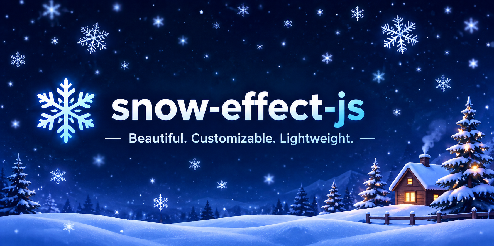

<p align="center">
  
</p>

# ❄️ snow-effect-js

A lightweight, zero-dependency canvas snow effect. Low CPU, RAM and GPU use, with custom **symbols, emoji, images and shapes**, and **any direction**. With no extra options it behaves exactly like the original v1 snow.

[](./LICENSE)

## Live demo

**[Explore the interactive snow-effect-js demo](https://kavineksith.github.io/snow-effect-js/demo/)**

The demo is hosted with GitHub Pages from `index.html`. Try the snow settings, directions, symbols, and visual options directly in your browser.

## Features

- **Original flow kept**: `direction: 'classic'` is the default, so v1 code works unchanged. Custom behaviour is opt-in.
- **Any direction**: top to bottom, bottom to top, left, right, diagonals, or any angle in degrees.
- **Custom particles**: text/emoji (`'❄'`, `'🎄'`), images, or built-in shapes (`circle`, `square`, `star`, `diamond`).
- **Low resource use**: see [Performance](#performance).
- **Theme aware**: white snow on dark, slate snow on light (or your own colours).
- **Responsive**: follows window or container size.
- **Accessible**: `aria-hidden`, no pointer events, honours `prefers-reduced-motion`.
- **Zero dependencies**, ESM + UMD/CJS + TypeScript types.

## Installation

```js
import SnowEffect from 'snow-effect-js';       // ESM
// const SnowEffect = require('snow-effect-js'); // CommonJS
```
## Quick start

```js
// Original behaviour: December only, white dots falling down
const snow = new SnowEffect().init();
```

```js
// Always on, 150 flakes
const snow = new SnowEffect({ enableSnow: true, particleCount: 150 }).init();
```

## Custom usage (opt-in)

```js
// Emoji falling straight down, slowly spinning
new SnowEffect({
  enableSnow: true,
  direction: 'top-to-bottom',
  symbols: ['🎄', '🎁', '⭐'],
  size: [14, 26],
  rotation: true
}).init();

// Embers rising up
new SnowEffect({
  enableSnow: true,
  direction: 'up',
  shape: 'circle',
  color: ['#fb923c', '#fde047'],
  speed: 0.6
}).init();

// Wind blowing left to right, text glyphs
new SnowEffect({ enableSnow: true, direction: 'left-to-right', symbols: ['❄', '❅', '❆'] }).init();

// Your own icons (use small images, ideally 64px or less)
new SnowEffect({ enableSnow: true, images: ['/img/leaf.png', '/img/petal.png'], size: [16, 28] }).init();

// Only inside one element
new SnowEffect({ enableSnow: true, container: document.querySelector('.hero') }).init();
```

## Options

| Option | Type | Default | Description |
|---|---|---|---|
| `isDark` | boolean | `true` | `true` = white snow, `false` = slate snow |
| `particleCount` | number | `100` | Number of flakes |
| `enableSnow` | boolean | December only | Force enable/disable |
| `container` | HTMLElement | `document.body` | Body = fixed fullscreen canvas. Any other element = canvas fills that element |
| `zIndex` | number | `9999` | CSS z-index of the canvas |
| `direction` | string \| number | `'classic'` | See [Directions](#directions) |
| `speed` | number | `1` | Speed multiplier |
| `sway` | number | `0.5` | Sideways wobble amplitude (`0` = none) |
| `size` | number \| [min, max] | `[2, 8]` / `[12, 24]` | Particle **diameter in px**. Dots default to `[2, 8]`, symbols and images to `[12, 24]` |
| `shape` | string \| string[] | `'circle'` | `circle`, `square`, `star`, `diamond` |
| `symbols` | string \| string[] | none | Text or emoji particles. Overrides `shape` |
| `images` | array | none | URLs, ``, `<canvas>` or `ImageBitmap`. Overrides `shape` |
| `color` | string \| string[] | theme colour | CSS colour(s) for shapes and text glyphs (emoji keep their own colours) |
| `opacity` | number | `0.8` shapes, `1` symbols/images | 0 to 1 |
| `rotation` | boolean \| number | `false` | Spin particles (number = spin speed multiplier). Costs a little more per frame |
| `maxFps` | number | `60` | Frame cap. `30` is great for low-power devices, `0` = uncapped |
| `pixelRatio` | number \| `'auto'` | `1` | Canvas resolution. `1` is cheapest, `'auto'` = device ratio up to 2 (crisper emoji) |
| `sizeSteps` | number | `6` | Pre-rendered sizes per symbol (1 to 12) |
| `fontFamily` | string | emoji-friendly stack | Font used for `symbols` |
| `respectReducedMotion` | boolean | `true` | Draw a still frame instead of animating when the user prefers reduced motion |

### Directions

| Value | Motion |
|---|---|
| `'classic'` (default) | Original v1 flow: falls down, sways, re-enters from the top (and sometimes the sides) |
| `'down'`, `'top-to-bottom'` | Top to bottom |
| `'up'`, `'bottom-to-top'` | Bottom to top |
| `'left'`, `'right-to-left'` | Right to left |
| `'right'`, `'left-to-right'` | Left to right |
| `'down-left'`, `'down-right'`, `'up-left'`, `'up-right'` | Diagonals |
| a number | Angle in degrees: `0` = right, `90` = down, `180` = left, `270` = up |

Flakes that leave the screen re-enter from the opposite edge, so density stays even in every direction.

## Methods

```js
snow.init();                          // create canvas and start (respects enableSnow)
snow.start();                         // resume after stop()
snow.stop();                          // pause (keeps the last frame, uses no CPU)
snow.setTheme(false);                 // light mode colours
snow.setDirection('left');            // change direction
snow.setOptions({ particleCount: 60, symbols: ['🍂'] }); // change most options live
snow.refresh();                       // rebuild sprites, e.g. after a web font loads
snow.destroy();                       // remove canvas and listeners
```

All methods except `destroy()` return the instance, so calls can be chained. `container` cannot be changed live: `destroy()` and create a new instance.

## Performance

- **Typed arrays** hold all particle state, so there is no per-frame allocation and no garbage-collection stutter.
- **Sprites**: each flake type and size is drawn once to a tiny offscreen canvas, then drawn with `drawImage` (cheap and GPU-friendly). No per-frame path building or `fillText`.
- **Time-based motion** with a clamped delta: speed does not depend on the display refresh rate, and tab restores never cause jumps.
- **FPS cap** (`maxFps`) and **pixelRatio 1** by default keep GPU and battery use low.
- **Nothing runs when stopped**: no animation frame is scheduled after `stop()` or `destroy()`.
- **Throttled resize**: at most one resize per frame, and existing flakes are rescaled, not re-created.

Tips: keep `particleCount` modest (50 to 150 looks full), keep images small (64px or less), and prefer `maxFps: 30` on mobile.

## Framework examples

### React

```jsx
import { useEffect, useRef, useState } from 'react';
import SnowEffect from 'snow-effect-js';

export default function App() {
  const snowRef = useRef(null);
  const [isDark, setIsDark] = useState(true);

  useEffect(() => {
    snowRef.current = new SnowEffect({ enableSnow: true, isDark }).init();
    return () => snowRef.current?.destroy();
  }, []);

  useEffect(() => {
    snowRef.current?.setTheme(isDark);
  }, [isDark]);

  return <button onClick={() => setIsDark(!isDark)}>Toggle theme</button>;
}
```

### Vue 3

```vue
<script setup>
import { onMounted, onBeforeUnmount } from 'vue';
import SnowEffect from 'snow-effect-js';

let snow;
onMounted(() => { snow = new SnowEffect({ enableSnow: true, symbols: ['❄'] }).init(); });
onBeforeUnmount(() => snow?.destroy());
</script>
```

### Server-side rendering

The module is safe to import on the server. Call `init()` only in the browser (for example inside `useEffect` or `onMounted`).

## Browser support

Any modern browser with Canvas 2D and `requestAnimationFrame` (Chrome, Edge, Firefox, Safari, Opera). Internet Explorer is not supported.

## Files in this folder

Everything is flat in one folder, no subfolders:

| File | What it is |
|---|---|
| `snow-effect.mjs` | ESM source. Edit this. Ends with `export { SnowEffect as default, SnowEffect };` |
| `build.mjs` | Zero-dependency build script. Reads the `.mjs`, strips the export, wraps it as UMD, writes the `.js` |
| `snow-effect.js` | The usable built file (UMD). Produced by `build.mjs`. Works as `<script>`, CommonJS and AMD |
| `snow-effect.test.mjs` | Node test suite. Tests the `.mjs` source and the built `.js` |
| `index.d.ts` | TypeScript types |
| `index.html` | Browser demo. Loads `./snow-effect.js` |
| `banner.png` | Header image |
| `LICENSE` | MIT |

## Manually build, test and create the usable JS file

You only need Node.js 18 or newer. No `npm install`, no dependencies to fetch.

### 1. Build the usable file

From this folder:

```bash
node build.mjs
```

This reads `snow-effect.mjs`, removes the trailing `export { ... }` line, wraps the body in a UMD shim and writes `snow-effect.js`. The output is unminified and ready to use as a plain `<script>`, as a CommonJS module (`require('./snow-effect.js')`), or as an AMD module.

To check syntax without running anything:

```bash
node --check snow-effect.mjs
node --check snow-effect.js
```

### 2. Test

```bash
node --test snow-effect.test.mjs
```

This runs the Node test runner. The suite imports the ESM source from `./snow-effect.mjs` and the UMD build from `./snow-effect.js`, so build first if you have changed the source.

### 3. Use the built file

After step 1, drop `snow-effect.js` into your project:

```html
<script src="./snow-effect.js"></script>
<script>
  var snow = new SnowEffect({ enableSnow: true }).init();
</script>
```

```js
// ESM
import SnowEffect from './snow-effect.js';
// CommonJS
const SnowEffect = require('./snow-effect.js');
```

### 4. Edit and rebuild

Edit `snow-effect.mjs`. Keep the trailing `export { SnowEffect as default, SnowEffect };` line — `build.mjs` looks for it. Then run `node build.mjs` again, then `node --test snow-effect.test.mjs`.

## Disclaimer

The software is provided as is. You are responsible for any images or fonts you use, and you should test performance on your target devices.

## License

[MIT](./LICENSE) © 2026 Kavin Eksith
